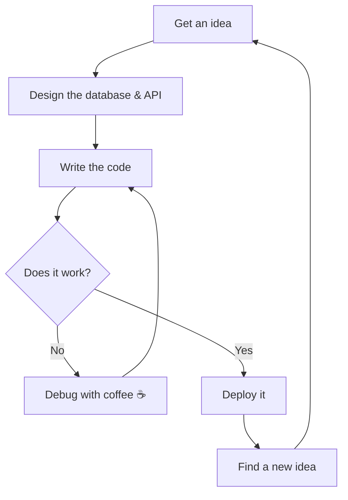
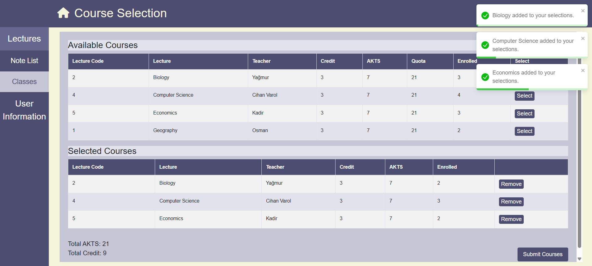
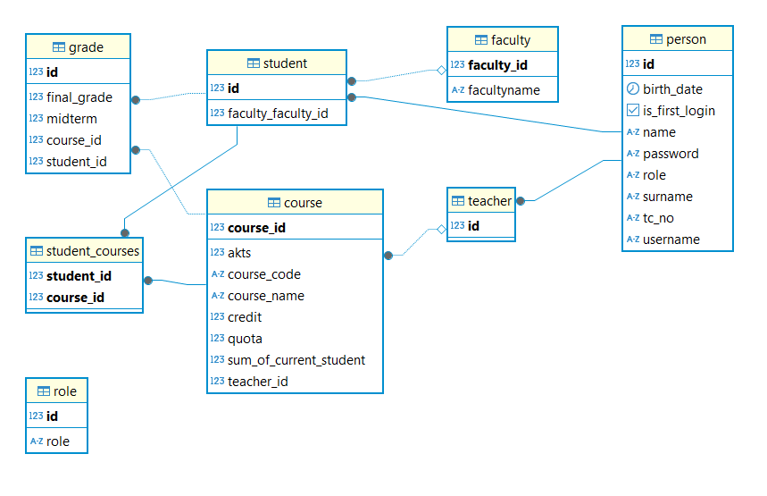
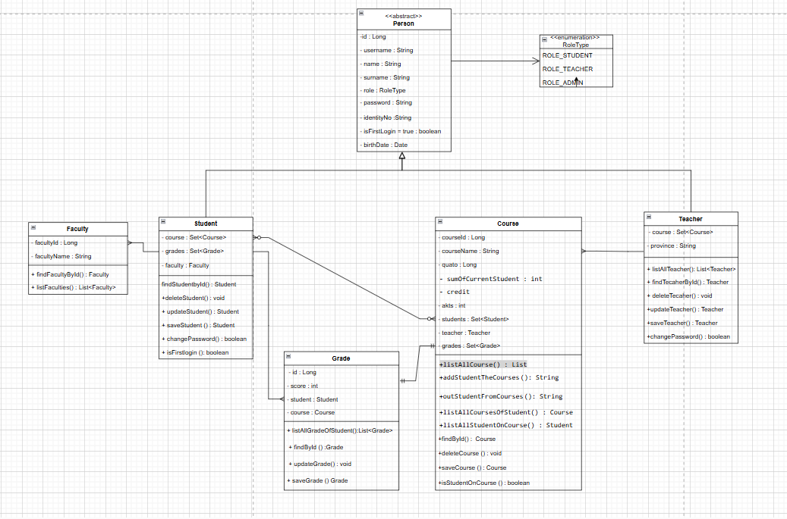
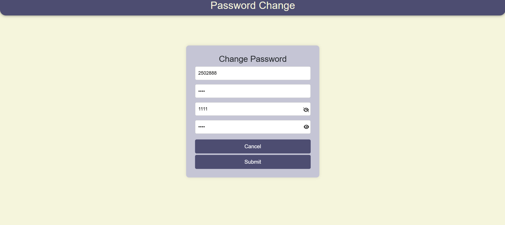

<h1 align="center">Hi, I'm Kadir 👋</h1>

  Software Engineering Student @ Sam Houston State University | Honors College | Backend & AI Agents 🤖

  

---

## 🧑‍🎓 About Me

---

## 🔁 How I Build Things

---

## 🛠️ Tech Stack

**Languages & Backend**

  

**Databases & Tools**

  

---

## 🧰 Projects

| Project | Description | Tech Used | Screenshot |
|:---:|---|:---:|:---:|
| [**Student Information System**](REPO_LINK_HERE) | Led a 3-person team to build a student information system from scratch with **29 RESTful API endpoints**. Designed the PostgreSQL schema and the frontend. Features course selection, grades, role-based access (student / teacher / admin) and password management. | Java, Spring Boot, PostgreSQL, JavaScript |  |
| [**AI Avatar Assistant**](REPO_LINK_HERE) | An AI-powered digital assistant deployed on a personal server, combining Gemini Live API and HeyGen Live Avatar API for real-time interactive conversations. | Gemini Live API, HeyGen API, Coolify | 🎙️ _Coming soon_ |
| [**AI Agent System**](REPO_LINK_HERE) | An AI agent workflow built with Claude Code and MCP to automate tasks using a team of agents. | Claude Code, MCP, Python | 🤖 _Coming soon_ |

<b>📸 More from the Student Information System</b>

 

**Database Schema (ER Diagram)**

**UML Class Diagram**

**Password Change Screen**

---

## 📈 GitHub Highlights

  

  
  

---

## 📫 Contact Me

  
  
  

---

<i>💡 Fun Fact: I moved across the world to study software — the hardest bug so far was the time zone difference.</i>

